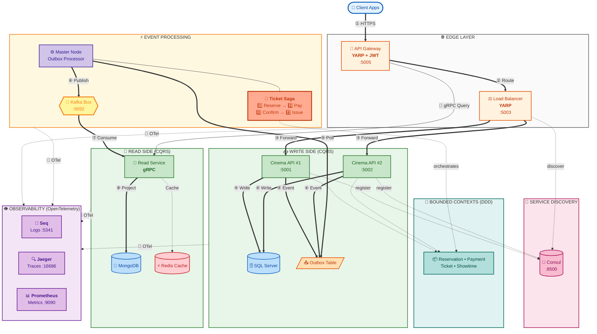

# Cinema Booking System

Distributed microservices cinema booking platform built with **.NET 8** and **Clean Architecture**. Implements **CQRS** (SQL Server write + MongoDB read), **Saga Orchestration** with compensation, **Transactional Outbox** via Kafka, **Consul** service discovery, and **JWT** authentication. Full observability via **OpenTelemetry** (Seq, Jaeger, Prometheus). Deployable to Docker Compose or Kubernetes with HPA-based autoscaling.

---

## Architecture Diagram



> **Legend:** `══►` main request flow  •  `──►` query/sync call  •  `┄┄►` async/registration/telemetry

---

## Quick Start

```bash
docker-compose -f docker-compose.infrastructure.yml up -d
docker-compose up -d
```

| Service | URL |
|---------|-----|
| API Gateway | http://localhost:5005 |
| Consul UI | http://localhost:8500 |
| Swagger | http://localhost:8080/swagger |
| Kafka UI | http://localhost:8090 |
| Seq (Logs) | http://localhost:5341 |
| Jaeger (Traces) | http://localhost:16686 |
| Prometheus | http://localhost:9090 |

## Kubernetes

```bash
kubectl apply -k k8s/
kubectl get pods -n cinema
```


